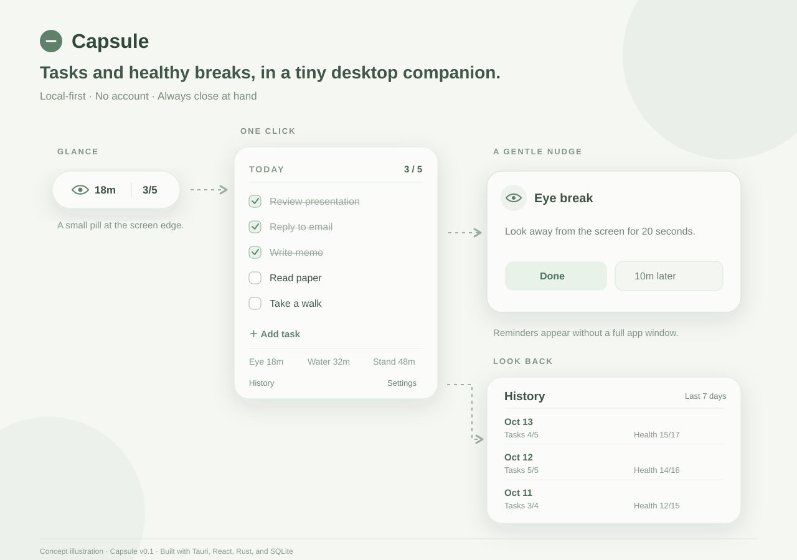

# Capsule — A Tiny Desktop Companion for Tasks & Healthy Breaks

## What is Capsule

Capsule is a small, local desktop companion that lives near the edge of the screen. It combines today's tasks with gentle eye, water, and movement reminders. Data stays on the device; no account, server, telemetry, or cloud sync is used.



*Concept illustration of the desktop interface.*

## Features

- One transparent, borderless, always-on-top capsule window; no traditional main window.
- A compact 110 × 32 logical-pixel collapsed view and small expanded panels.
- Five calm capsule color themes in Settings: original sage, charcoal, light gray, soft blue, and soft yellow. The choice is saved locally and restored on launch.
- Click to expand, click outside or use the collapse button to tuck it away.
- Drag the capsule or its expanded header. The initial location is near the right edge of the primary display.
- Add, complete, uncomplete, delete, and reorder today's tasks. Tasks are stored in SQLite and remain available in history.
- Manually continue an unfinished task to tomorrow, or bring individual unfinished tasks from earlier days into today (with a Bring all shortcut). Each new daily copy shows the original creation date; earlier daily records stay in history.
- Rust schedules independent Eye, Water, and Stand reminders even while the capsule is collapsed. Done and Snooze are recorded as events.
- When a reminder is due, a compact card appears at the center of the capsule's monitor with a Windows system chime. It retracts after ten seconds and can appear once more after ninety seconds. Sound and repeat can be disabled in Settings; quiet hours suppress both.
- Change intervals, snooze lengths, and quiet hours without restarting. Missed reminders are not replayed after sleep or quiet hours.
- Browse today, seven days, or thirty days of task and reminder completion, with daily details and rates.

## Tech stack

Tauri 2, React 19, TypeScript, Vite, Rust, rusqlite, SQLite, chrono, and Zustand. The packaged app has no web backend, account, cloud database, telemetry, or tracking.

## Development

On Windows, install [Rust with the MSVC toolchain](https://v2.tauri.app/start/prerequisites/) and Microsoft C++ Build Tools with **Desktop development with C++**. WebView2 is also required. Then run:

```powershell
npm install
npm run tauri dev
```

If the linker is not found in a normal terminal, run these commands from a Visual Studio Developer PowerShell or Developer Command Prompt.

## Build

`npm run build` checks TypeScript and builds the frontend. `npm run tauri build` builds a desktop bundle after the native prerequisites are installed.
Run Rust unit tests with `cargo test` from `src-tauri/`.

## Project structure

```text
src/
  components/Capsule/     Floating window states and interactions
  components/Todo/        Inline task entry and list
  components/Reminder/    Countdown and alert
  components/Settings/    Reminder and quiet-hours controls
  components/History/     Date list and detail
  stores/                 Zustand UI state and backend snapshots
  lib/                    Typed Tauri commands and window bridge
  types/                  Frontend data contracts
src-tauri/
  src/database.rs         SQLite initialization and task access
  src/reminder.rs         Reminder rules and events
  src/scheduler.rs        Rust reminder clock, quiet hours, wake handling
  src/attention.rs        Reminder presentation and optional system chime
  src/history.rs          Daily statistics derived from source tables
  src/commands.rs         Typed Tauri commands
  src/window.rs           Window position and sizing
  src/models.rs           Serialized data structures
  src/lib.rs              Application setup
```

## Architecture

Rust owns the native window, SQLite, reminder schedule, and the timing of the center-screen reminder card. The scheduler keeps the true next-trigger times and emits Tauri events when reminders occur, settings change, or the date rolls over. React renders the UI and displays a countdown from Rust timestamps; its one-second interval never decides when a reminder fires or repeats. Zustand holds temporary UI state and backend snapshots, not persistent storage.

## Database schema

The database is `capsule.sqlite3` in Tauri's standard app data directory. Versioned migrations create four tables: `tasks`, `reminder_rules`, `reminder_events`, and key-value `app_settings`. Tasks store their local `YYYY-MM-DD` date. A manual carry creates a new daily task while preserving the earlier row, its incomplete history, and the original creation timestamp. Reminder events store scheduled and action timestamps, a persisted snooze deadline, and `triggered`, `completed`, `snoozed`, or `skipped` status. History is calculated from tasks and reminder events; there is no redundant statistics table.

## Roadmap

- **v0.1:** Capsule, Todo, manual task carry, Reminder, History, color themes.
- **v0.2:** Reminder merge, idle detection, heatmap, keyboard shortcut.
- **v0.3:** Fullscreen detection and carry-over polish.

Window position persistence, edge snapping, and launch at startup remain desktop-polish work. Reminder merging, idle detection, and the heatmap remain outside v0.1.
